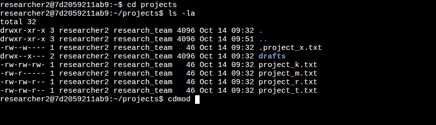
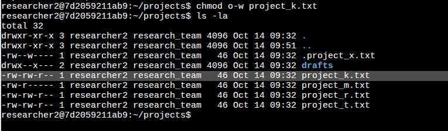
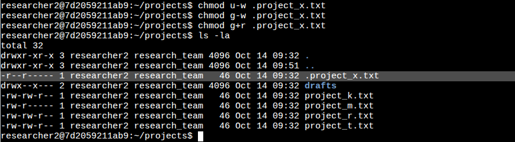
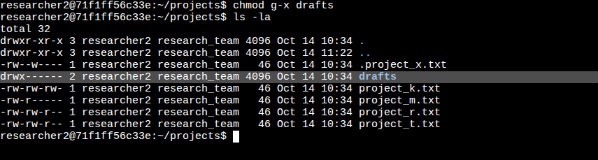

# File Permissions in Linux

> This lab and its scenario come from the Google Cybersecurity Certificate. I completed it in the course's Linux environment and wrote this report.

## Project description

A research team's project files need to match the organization's access rules. My task was to check the current permissions in the `projects` directory, find anything that gave more access than allowed, and fix it from the command line. This follows the principle of least privilege: each user gets only the access they need.

## Skills and tools

- Linux command line (Bash)
- `ls -la` to view permissions and hidden files
- `chmod` to change permissions
- Principle of least privilege

## Check file and directory details

I moved into the `projects` directory and ran `ls -la`. The `-l` option lists permissions, and the `-a` option shows hidden files, whose names start with a period.

```bash
cd projects
ls -la
```

```text
drwxr-xr-x 3 researcher2 research_team 4096 Oct 14 09:32 .
drwxr-xr-x 3 researcher2 research_team 4096 Oct 14 09:51 ..
-rw--w---- 1 researcher2 research_team   46 Oct 14 09:32 .project_x.txt
drwx--x--- 2 researcher2 research_team 4096 Oct 14 09:32 drafts
-rw-rw-rw- 1 researcher2 research_team   46 Oct 14 09:32 project_k.txt
-rw-r----- 1 researcher2 research_team   46 Oct 14 09:32 project_m.txt
-rw-rw-r-- 1 researcher2 research_team   46 Oct 14 09:32 project_r.txt
-rw-rw-r-- 1 researcher2 research_team   46 Oct 14 09:32 project_t.txt
```



The directory contains five files, including one hidden file, and one subdirectory called `drafts`.

| Name | Permissions | User | Group | Other |
|---|---|---|---|---|
| `.project_x.txt` | `-rw--w----` | read, write | write | none |
| `drafts` | `drwx--x---` | read, write, execute | execute | none |
| `project_k.txt` | `-rw-rw-rw-` | read, write | read, write | read, write |
| `project_m.txt` | `-rw-r-----` | read, write | read | none |
| `project_r.txt` | `-rw-rw-r--` | read, write | read, write | read |
| `project_t.txt` | `-rw-rw-r--` | read, write | read, write | read |

## Describe the permissions string

Each permissions string has 10 characters:

| Position | Meaning |
|---|---|
| 1st | File type: `d` for a directory, `-` for a regular file |
| 2nd to 4th | Read (`r`), write (`w`), and execute (`x`) for the **user** who owns the file |
| 5th to 7th | Read, write, and execute for the **group** |
| 8th to 10th | Read, write, and execute for **other**, meaning everyone else on the system |

A hyphen in any of the last nine positions means that permission is not granted.

For example, `project_t.txt` has the string `-rw-rw-r--`:

- `-`: It's a regular file.
- `rw-`: The user can read and write it, but not execute it.
- `rw-`: The group can read and write it, but not execute it.
- `r--`: Others can only read it.

## Change file permissions

The organization doesn't allow other to have write access to any file. `project_k.txt` was the only file that broke this rule, so I removed write permission for other:

```bash
chmod o-w project_k.txt
ls -la
```

```text
-rw-rw-r-- 1 researcher2 research_team   46 Oct 14 09:32 project_k.txt
```



In `chmod`, `o` means other, `-` removes a permission, and `w` means write.

## Change file permissions on a hidden file

The team archived `.project_x.txt`, which is why it's hidden. Nobody should be able to write to it, but the user and group should be able to read it. I removed write permission from the user and group, then added read permission for the group:

```bash
chmod u-w .project_x.txt
chmod g-w .project_x.txt
chmod g+r .project_x.txt
ls -la
```

```text
-r--r----- 1 researcher2 research_team   46 Oct 14 09:32 .project_x.txt
```



The same change can be made in one command: `chmod u-w,g-w,g+r .project_x.txt`

## Change directory permissions

Only `researcher2` should be able to access the `drafts` directory and its contents. The user already had full permissions, but the group had execute permission. Execute on a directory lets someone enter it, so I removed it:

```bash
chmod g-x drafts
ls -la
```

```text
drwx------ 2 researcher2 research_team 4096 Oct 14 10:34 drafts
```



Now only `researcher2` can read, write, or enter `drafts`.

*The lab environment restarted before this step, so the screenshot shows the other files with their original permissions.*

## Summary

I checked the permissions in the `projects` directory, including a hidden file, against the organization's rules. Three items gave more access than allowed. I used `chmod` to remove write access for other from `project_k.txt`, make `.project_x.txt` read-only for the user and group, and limit `drafts` to its owner. Each change reduced access to only what the team needed.
