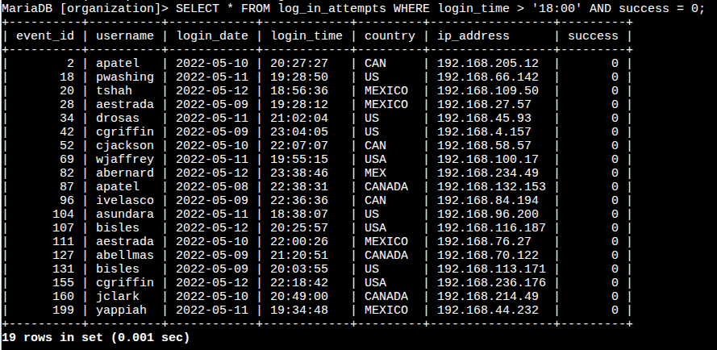
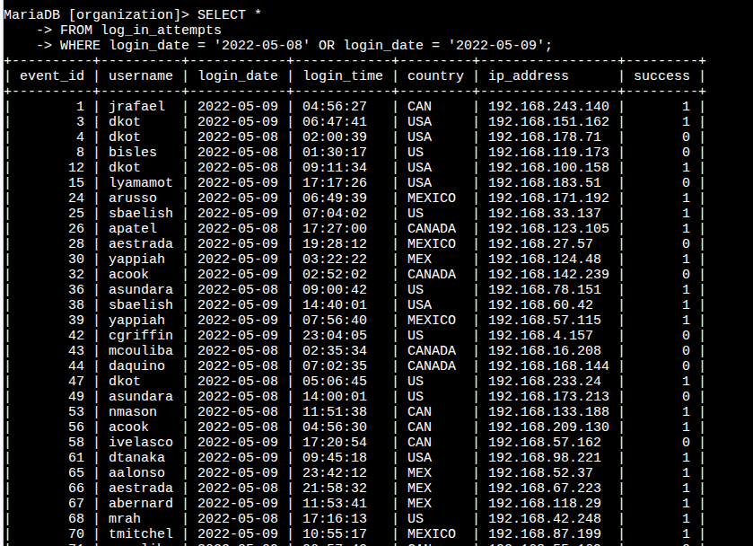
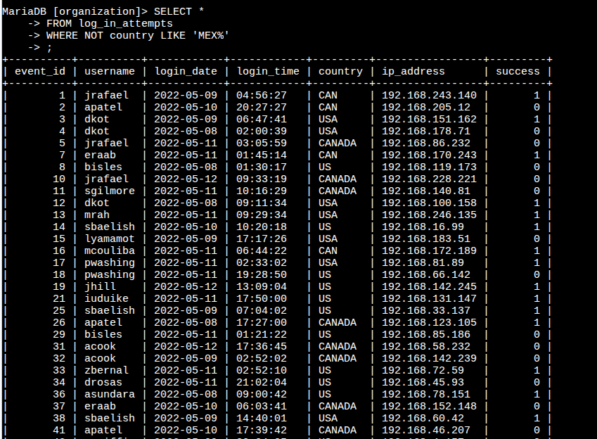
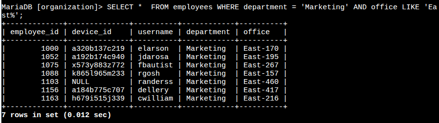
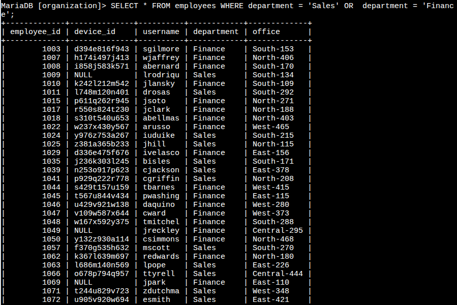
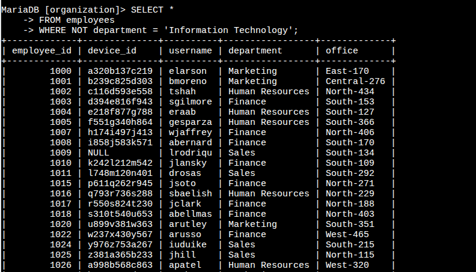

# Apply Filters to SQL Queries

> This lab and its scenario come from the Google Cybersecurity Certificate. I completed it in the course's MariaDB environment and wrote this report.

## Project description

I'm a security analyst investigating suspicious login attempts and preparing security updates for employee machines. I used SQL to filter two tables in the organization's database: `log_in_attempts`, which records each login, and `employees`, which links employees to their machines and offices. Filtering let me pull only the records each task needed, instead of reviewing whole tables by hand.

## Skills and tools

- SQL (MariaDB)
- `WHERE` filters
- `AND`, `OR`, and `NOT` operators
- `LIKE` with the `%` wildcard
- Log analysis

## The tables

| Table | Columns used |
|---|---|
| `log_in_attempts` | `login_date`, `login_time`, `country`, `success` |
| `employees` | `department`, `office` |

## Retrieve after hours failed login attempts

A potential security incident happened after business hours, so I needed every failed login after 18:00.

```sql
SELECT *
FROM log_in_attempts
WHERE login_time > '18:00' AND success = 0;
```

- `login_time > '18:00'` keeps logins after 6 p.m.
- `success = 0` keeps failed attempts, since `0` means the login failed.
- `AND` returns only rows that meet **both** conditions.

The query returned 19 failed logins.



## Retrieve login attempts on specific dates

A suspicious event happened on 2022-05-09, so I reviewed every login from that day and the day before.

```sql
SELECT *
FROM log_in_attempts
WHERE login_date = '2022-05-09' OR login_date = '2022-05-08';
```

`OR` returns rows that meet **either** condition. `AND` wouldn't work here, because a single login can't happen on two dates.



## Retrieve login attempts outside of Mexico

The team found that the suspicious activity didn't come from Mexico, so I filtered Mexico out.

```sql
SELECT *
FROM log_in_attempts
WHERE NOT country LIKE 'MEX%';
```

- The `country` column records Mexico as both `MEX` and `MEXICO`.
- `LIKE 'MEX%'` matches both, because `%` stands for any number of characters, including none.
- `NOT` reverses the match, so the query returns every login **outside** Mexico.



## Retrieve employees in Marketing

The team needed to update machines for Marketing employees in the East building.

```sql
SELECT *
FROM employees
WHERE department = 'Marketing' AND office LIKE 'East%';
```

- `department = 'Marketing'` keeps Marketing employees.
- `office LIKE 'East%'` matches any East office, such as `East-170` or `East-320`.
- `AND` requires both conditions.

The query returned 7 employees.



## Retrieve employees in Finance or Sales

A different update was needed for employees in Sales and Finance.

```sql
SELECT *
FROM employees
WHERE department = 'Sales' OR department = 'Finance';
```

Even though the task asks for Sales **and** Finance employees, the query needs `OR`. Each employee belongs to one department, so `AND` would return no rows.



## Retrieve all employees not in IT

The Information Technology department already had the final update, so I needed everyone else.

```sql
SELECT *
FROM employees
WHERE NOT department = 'Information Technology';
```

`NOT` returns every employee whose department isn't Information Technology. The same result could be written with `department <> 'Information Technology'`.



## Observation

Some employees in these results have `NULL` in the `device_id` column, such as `randerss` in Marketing. These machines are missing from the records, so they could be skipped during the security updates. I'd flag them for the IT team to check.

## Summary

I used SQL filters to investigate suspicious login activity and to find the employee machines that needed security updates. I filtered `log_in_attempts` by time, date, success, and country, and filtered `employees` by department and office. `AND` narrowed results to rows that met every condition, `OR` combined separate groups, and `NOT` excluded records. `LIKE` with `%` matched patterns, such as both spellings of Mexico and every office in the East building.
